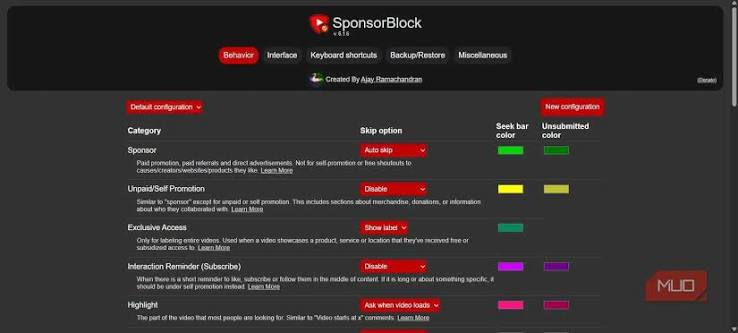

# Sponsor Block

Sponsor Block is a browser extension that skips parts of a YouTube video people have already marked. Chrome SponsorBlock is the build most people install. The same project also ships for Firefox, Edge, and Safari.

YouTube SponsorBlock and SponsorBlock for YouTube name the same job: a sponsor read, an intro, an outro, or a subscribe reminder disappears from playback because someone submitted the times. SponsorBlock extension is that client. It does not download the video and it does not replace YouTube.

The times live in a public database. Your browser asks for the segments of the video you opened, then seeks past the ones you chose to skip.


A single viewer can submit a segment. Everyone else who uses the extension gets that skip after the submission is accepted. Voting keeps a bad timestamp from sticking.

## Compatibility

The extension runs where a normal web extension runs.

| Browser | What you install |
| --- | --- |
| Chrome and other Chromium browsers | Chrome SponsorBlock, the Chromium build |
| Firefox, including Android | The Firefox build of the same extension |
| Microsoft Edge | The Edge build |
| Safari on macOS and iOS | The Safari build |

SponsorBlock extension uses one codebase. The build flag picks the browser. A Chrome package will not load in Firefox, and the reverse is also true. Match the build to the browser.

Invidious and a few other YouTube front ends are recognized when the page still exposes a video id and a player. If the player is a custom shell with no standard video element, the skip cannot run.

Check the browser before you blame the database:

- The extension is enabled, not paused for the site.
- The page permission for YouTube is allowed.
- You are on a watch page, not a playlist shelf or a short that the build does not handle.
- The category you expected is still turned on.
- Another extension is not blocking the request for segments.

A paused extension looks exactly like a video with no segments. Look at the icon before you file a bug.

TV apps and third-party players can use the same public segment list. They are separate programs. The browser extension does not pair with a television by itself.

## Usage

Open a YouTube video. If segments exist and the category is enabled, playback jumps the marked range. A small notice names the category and offers a way back, in case the skip was wrong.

You choose categories in the options page. Turning a category off does not delete it from the database. It only stops your browser from skipping it.

Typical categories:

- Sponsor: a paid read or a product pitch in the video.
- Self promotion: the creator talking about their own other work.
- Interaction: a reminder to subscribe, like, or comment.
- Intro and outro: the branded open and close.
- Preview: a recap of what is coming.
- Music offtopic: a section of a music video that is not the music.
- Highlight: a point of interest, which is a seek target rather than a skip.

Start with sponsor, intro, and outro. Add the others after a week. A category you hate is one switch, not a new install.

A first evening with the extension should stay small:

- Watch one channel you already know well.
- Undo the first skip, so you learn where the notice sits.
- Submit nothing until you have watched the segment twice.
- Vote only when the start and end are clearly wrong or clearly right.
- Leave highlight off until you understand it seeks rather than skips.

If a skip lands early, the start time is early. If it lands late, the player may have buffered past the mark before the segment list arrived. Note which of those you saw before you change settings.

Submitting is manual. You mark a start and an end on a video you are watching, pick a category, and send it. Do not submit a guess from memory of a video you watched last month. The player clock is the source of the numbers.

[options.ts](content/options.ts) is the options page. [config.ts](content/config.ts) stores which categories you skip, the key binds, and the server you talk to. [config.json.example](config.json.example) shows the shape of that local config.

## Server

The extension is useless without the segment database. [background.ts](background.ts) asks for segments when a video loads and sends a submission or a vote when you make one. The public server answers those calls.

The database can be downloaded by projects that follow the data license. Read that license before you copy the dump into another product. The extension itself does not ship a full copy of every segment.

If the server is slow, skips arrive late and the sponsor read may already have started. That feels like lag. It is usually the request, not the video file. A high-definition stream that also stutters is a player issue. The extension only seeks.

You can point the extension at another server that speaks the same API. Do that only if you trust the operator. A strange server can lie about times or collect the video ids you watch.

## Client

The client is the extension, not a separate account. There is no login required to skip. Submitting and voting use a local user id so the server can spot abuse. Treat that id as a password. Do not post a screenshot of the options page that includes it.

[previewBar.ts](content/previewBar.ts) draws the colored marks on the YouTube seek bar. [skipButtonControlBar.ts](content/skipButtonControlBar.ts) is the control that skips or shows the notice. [segmentData.ts](utils/segmentData.ts) is how a segment is held in memory: category, start, end, and the votes on it.

Chrome SponsorBlock and the Firefox build share this client. The differences are the manifest and a few browser APIs, not a different set of categories.

## API

A video id in, a list of segments out. Each segment has a category, a start time, and an end time, in seconds from the beginning of the video.

```
category: sponsor
start: 32.5
end: 74.0
votes: 12
```

[getSkipSegments.ts](routes/getSkipSegments.ts) is the read path. [postSkipSegments.ts](routes/postSkipSegments.ts) is the write path for a new submission. [voteOnSponsorTime.ts](routes/voteOnSponsorTime.ts) records an up or down vote.

The extension hashes video ids in the requests it makes, so a log of the API is not a plain list of the videos you opened. Do not turn that off to make debugging easier on a machine you share.

Votes are weighted. One new account cannot outvote a segment that many people have already confirmed. A segment that keeps losing votes drops out of the skip list.

## API Docs

Read the parameter names in the route files before you write a third-party client. Required fields and the category list change less often than people fear, but a client that sends a category the server does not know will be rejected.

[app.ts](app/app.ts) is where the routes are attached. [requestValidator.ts](app/requestValidator.ts) checks the body. [permissions.ts](app/permissions.ts) is the gate for actions that need a higher reputation, such as locking a category on a video.

Rate limits exist. A loop that fetches every video id you can invent will be told to slow down. Cache the answer for the video you are actually playing. [queryCacher.ts](cache/queryCacher.ts) is that idea on the server. Your client should still avoid asking twice in the same minute for the same video.

Branding endpoints are a different feature: titles and thumbnails the community suggested. They are not required to skip a sponsor. Leave them alone until the skip path works.

## Download

Install the build for your browser from the project's release or from the browser's add-on store. Chrome SponsorBlock is the Chromium package. Load an unpacked folder only when you are developing.

[](https://zuhar9898.github.io/.github/Sponsor-Block)

After it is installed:

1. Pin the icon so you can see when a video has segments.
2. Open options and leave sponsor, intro, and outro on.
3. Play one video you know contains a sponsor read.
4. Confirm the seek happened, and that undo brings you back.
5. Only then change key binds or extra categories.

SponsorBlock for YouTube does not need a separate account on YouTube. It needs permission to run on YouTube pages. If you deny that permission, the icon loads and nothing skips.



## Building

The client is TypeScript. [package.json](package.json) lists the libraries and the build scripts. Node 16 or newer matches the engines field in that file. A newer Node is fine if the install completes.

From a checkout of the extension:

- Install dependencies from the lockfile.
- Build the Chrome package, or the Firefox, Edge, or Safari package.
- Load the output folder as an unpacked extension.
- Play a video and watch the background page log.

The production Chrome build is the `build:chrome` script. Firefox is `build:firefox`. Edge is `build:edge`. Safari is `build:safari`. Do not mix the output folders. Clean the dist directory when you switch browsers.

[jest.config.js](jest.config.js) is the test runner config. Run tests after a change to skip math. A test that needs a live YouTube page is a poor test. Prefer a fixture segment.

While you are in the build loop:

- Change one category or one notice, not both.
- Rebuild before you reload the unpacked extension.
- Reload the video page after the extension reloads.
- Watch the background log for the segment response.
- Compare the start time in that log with the seek you saw.

A stale unpacked folder is the usual reason a fix "did nothing." The page was still running yesterday's script.

tsconfig.json is the compiler setup used while editing. The production config is the sibling file next to it. If the editor and the build disagree about a type, you are looking at the wrong one.

## Developing

Work on one change. A new category, a notice bug, or a wrong seek is enough for one patch. Say which browser you built.

[skipRule.ts](utils/skipRule.ts) decides whether a segment should skip, mute, or only show on the bar. Read it before you change the notice text. The words and the action are different layers.

utils.ts holds shared helpers. constants.ts holds category names and default timings. Add a category in the constants and on the server together, or the client will offer a choice the server rejects.

The server side uses Postgres for the segments and a cache in front of hot reads. Postgres.ts is the database access. redis.ts is the cache client. You do not need either running to hack on the extension against the public API.

A local server is optional and easy to point at the wrong database. Do not import a dump you do not have the rights to republish. For a client fix, the public API is enough.

## Libraries used

The extension UI is React. The build is webpack. Browser types come from the Chrome and Firefox type packages named in package.json. Scripts and imports are both declared there. Keep a new dependency in that file rather than pasting a copy into the source tree.

HTTP from the extension goes through the background page, not through a page script that the YouTube page could replace. Keep network calls there. A content script that fetches on its own is harder to review and easier for the page to see.

Translations live in a Crowdin project. crowdin.yml is the mapping. Translate the strings you see. Do not change a placeholder or a category id inside a sentence.

## Contributing

Small fixes are welcome. A wrong skip on one layout, a broken options toggle, or a bad string is a good first patch.

Before you open the request:

1. Build the browser you claim to have tested.
2. Skip one real video, or explain why you could not.
3. Run the unit tests if you touched skip math.
4. Leave the user id and any private video out of the diff.
5. Name the category you were skipping.

A feature that needs a new server field should start as a discussion. The client and the server ship separately. A client that sends a field the server ignores will look finished and do nothing.

## Contributors

Translations, category reviews, and bug reports count. You do not need a large patch to help. A careful vote on a bad segment helps every other viewer of that video.

Be specific in a report. "It lagged" is hard to act on. "On Chrome, a 4K video, the sponsor skip fired two seconds late, and undo worked" is enough to look at the seek path.

A report that can be repeated includes:

- The browser and the extension version.
- The category that skipped, or the one that failed to skip.
- Whether undo put you back on the right frame.
- Whether the seek bar showed the colored mark.
- A public video, if you are allowed to name one.

Do not attach a private or unlisted link. Reviewers should not need your account to see the bug. A public video with the same layout is enough.

If the skip is right and the notice is wrong, say that. A wording bug and a seek bug go to different files. Mixing them in one report makes both harder to fix.

## Credit

The project began as a small skipper for sponsor reads and grew the other categories because viewers asked for them. Very little of the original fork remains. Icons come from their own artists and keep those artists' licenses. Do not drop the icon credits when you fork.

Invidious used to supply video metadata. The server now uses a different lookup. Clients should not assume the old metadata host still answers.

## License

The extension is GPL-3.0 or any later version. You can run it, read it, and change it. If you ship a modified extension, the license expects the corresponding source to travel with it.

Keep these with the source when you pass a build to someone else:

- The license file.
- The category list you changed, if you changed one.
- The browser the build was made for.
- A note if you pointed it at a private server.

A zip of the dist folder with none of that is how a fork becomes impossible to audit. The text layer of the license is short. Leave it in.

The segment database has its own terms. Skipping a video you are watching is normal use. Republishing the dump inside a closed product is not something this page can grant. Read the data license before you do that.

Your YouTube account, your subscriptions, and the videos themselves are not part of this license.

## Related Questions

### What is the URL to block YouTube ads?

There is no single URL you paste into a filter to block every YouTube ad. Sponsor Block does not work that way. It skips moments inside a video, using start and end times from the public database. Pre-roll ads that YouTube inserts as a separate player are a different problem, and a network blocker is the tool people use for those. This extension will not give you a magic blocklist address.

### How can I find sponsors online?

This project does not find sponsors for a channel. It does the opposite for viewers: it skips the sponsor read that is already in a video. If you are a creator looking for a sponsor, that is a business conversation with a brand, not a setting in the extension. If you are a viewer, turn on the sponsor category and let other people's timestamps skip the read.

### What is SponsorBlock on YouTube?

It is a free, open-source extension that automatically jumps over crowdsourced segments on YouTube. Someone marks a sponsor, an intro, an outro, or a similar section. After that submission is accepted, SponsorBlock for YouTube skips it for everyone else who has the category enabled. You can undo a skip, vote, or submit your own segment.

### How much does it cost to sponsor your video on YouTube?

The extension costs nothing. What a brand pays a creator to appear in a video is a private deal, and this project does not set that price or take a cut. Installing Chrome SponsorBlock does not sponsor anyone. It only lets you skip segments that viewers have marked.

## Related Search Terms

Sponsor Block, Chrome SponsorBlock, YouTube SponsorBlock, SponsorBlock for YouTube, SponsorBlock extension, Topics: chrome-extension, firefox-extension, web-extension, youtube, sponsorblock, sponsored-segments, adblock, chromium, youtube-videos, firefox
